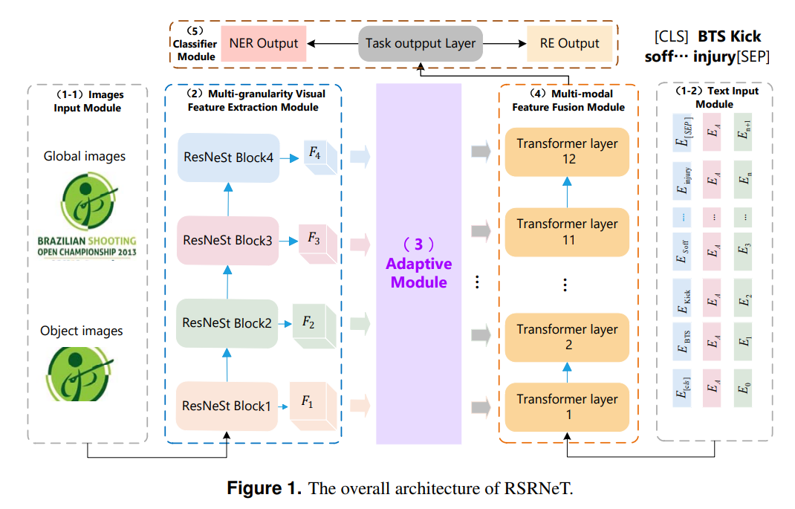
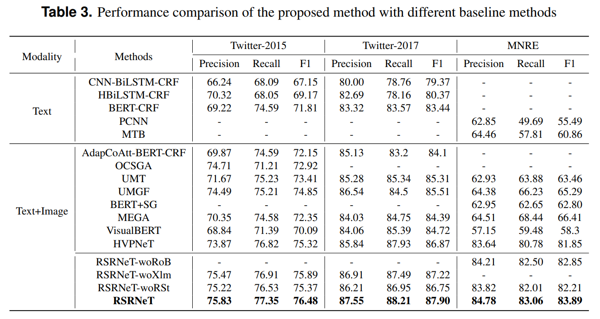

# Correction (2026-11)

The SAVER results in the README at commit `1e38beec`, including every table
under “Main Results (SAVER),” are retracted. Our audit found no supporting
run records for those numbers. It also found no run records for the
five-seed NVIDIA A800 protocol, the checkpoint profiling commands, or the
MRE-MI and MNER-MI-Plus configurations below. The logged reproduction did
not run any of them.

The logged reproduction in [`reproduction/`](reproduction/README.md) used
MNRE only, with frozen ModernBERT and SigLIP 2 encoders and a single NVIDIA
T4 per GPU run. In the uncapped MNRE comparison, the always-vision model
showed no measurable development-set improvement over the independently
trained text-only model under the preregistered decision rule. The full
development set also served for early stopping. Test results were descriptive. See the
[logged reproduction findings](#logged-reproduction-reproduction).

# SAVER

This repository contains a SAVER implementation alongside the original
RSRNeT code and the logged reproduction harness.

The top-level SAVER implementation uses:

- `answerdotai/ModernBERT-base` for text
- `google/siglip2-base-patch16-naflex` for every attached image
- a low-patch global screen for all attachments
- a learned unit-level gate with an equal-input parameter-free MaxSim control
- top-ranked attachment retrieval by default
- high-patch SigLIP 2 re-encoding for selected, active attachments
- a direct marked-pair head for MRE and start/end/max/width span enumeration
  for MNER
- a text-only path when the gate is off
- an attachment-indexed patch bank that gathers only the selected detailed
  patch features across MNER spans

The selector also implements `selection_type: facility` for budgets that
allow multiple selected attachments. Configuration validation rejects
facility-location when the budget permits only one image.

`models/saver.py` contains the architecture and simultaneous
Clopper–Pearson calibration rule. `processor/saver_dataset.py` defines the
shared multi-image JSONL data contract. `modules/saver_trainer.py` implements
forced-vision warm-up and gate-floor annealing. Training saves `last.pt` and
reloads the best development checkpoint before calibration. It also
writes `best.pt` and `final.pt`.

## SAVER setup

Install the dependencies for the top-level SAVER implementation.

```shell
python -m pip install -r requirements-saver.txt
```

The MRE-MI and MNER-MI-Plus configurations expect the split format in
[`data/manifest_schema.md`](data/manifest_schema.md).

### Manifest validation and training examples

The examples use the MRE-MI configuration. The corresponding MNER-MI-Plus
configuration is `configs/saver_mner_mi_plus.yaml`.

```shell
python run_saver.py --config configs/saver_mre_mi.yaml --mode validate-data
```

```shell
python run_saver.py \
  --config configs/saver_mre_mi.yaml \
  --mode train \
  --seed 42 \
  --output-dir result/saver_mre_mi/seed_42
```

### Five-seed, single-GPU NVIDIA A800 protocol

```shell
bash scripts/run_saver_a800.sh
```

### A800 checkpoint profiling

The timer is designed to include preprocessing, host-to-device transfer,
both backbone stages, routing, and the task head. Timing starts after disk
I/O and model loading.

```shell
bash scripts/profile_saver_a800.sh \
  configs/saver_mre_mi.yaml \
  result/saver_mre_mi/seed_42/final.pt
```

### Unit tests

```shell
python -m unittest discover -s tests -v
```

## Logged reproduction (reproduction/)

See the [reproduction guide](reproduction/README.md) for code provenance,
inputs, runner commands, and table generation.

- In the original capped MNRE runs, always-vision test micro F1 was
  `0.3759 ± 0.0142 (n=3)`, compared with `0.4013 ± 0.0170 (n=3)` for the
  independently trained text-only model. [`p24_mre_main.md`](reproduction/results/tables/p24_mre_main.md)
- The original SAVER checkpoint's all-off path had lower test F1 than
  the independent text-only model at every logged seed. The paired deltas
  were `-0.38269`, `-0.34510`, and `-0.36542`.
  [`p24_phase3_R2_test.md`](reproduction/results/tables/p24_phase3_R2_test.md)
- The uncapped A6 comparison was designed after earlier test results had
  been seen. Selection used only the development set, and test results
  were descriptive. Always-vision minus text-only development micro F1
  was `-0.02863`, `0.00684`, and `0.00735` for the seeds in table
  order. All paired whole-post bootstrap intervals included zero.
  [`p24_phase5_A6_paired_s42.md`](reproduction/results/tables/p24_phase5_A6_paired_s42.md),
  [`p24_phase5_A6_paired_s43.md`](reproduction/results/tables/p24_phase5_A6_paired_s43.md),
  [`p24_phase5_A6_paired_s44.md`](reproduction/results/tables/p24_phase5_A6_paired_s44.md)
- The registered uncapped decision recorded `Go = 0`, with `2` positive
  seeds and `0` seeds with a positive confidence-interval lower bound.
  The full development set also served for early stopping. The test set
  was excluded from this decision. [`p24_phase5_C3.md`](reproduction/results/tables/p24_phase5_C3.md)

- In the post hoc replay of the uncapped development set, the pooled
  one-sided 95% upper bound on always-vision minus text-only micro F1 was
  `0.01186`. The paired bootstrap shared post draws across the three
  fitted models and was conditional on those models.
  [`p24_phase6_E1a_dev.md`](reproduction/results/tables/p24_phase6_E1a_dev.md)

## Legacy RSRNeT

### The overall architecture of RSRNeT.


### Historical RSRNeT performance comparison


Requirements
==========
To run the codes, you need to install the requirements:
```
pip install -r requirements.txt
```

Data Preprocess
==========
To extract visual object images, we first use the NLTK parser to extract noun phrases from the text and apply the [visual grouding toolkit](https://github.com/zyang-ur/onestage_grounding) to detect objects. Detailed steps are as follows:

1. Using the NLTK parser (or Spacy, textblob) to extract noun phrases from the text.
2. Applying the [visual grouding toolkit](https://github.com/zyang-ur/onestage_grounding) to detect objects. Taking the twitter2015 dataset as an example, the extracted objects are stored in `twitter2015_aux_images`. The images of the object obey the following naming format: `imgname_pred_yolo_crop_num.png`, where `imgname` is the name of the raw image corresponding to the object, `num` is the number of the object predicted by the toolkit. (Note that in `train/val/test.txt`, text and raw image have a one-to-one relationship, so the `imgname` can be used as a unique identifier for the raw images)
3. Establishing the correspondence between the raw images and the objects. We construct a dictionary to record the correspondence between the raw images and the objects. Taking `twitter2015/twitter2015_train_dict.pth` as an example, the format of the dictionary can be seen as follows: `{imgname:['imgname_pred_yolo_crop_num0.png', 'imgname_pred_yolo_crop_num1.png', ...] }`, where key is the name of raw images, value is a List of the objects.

The detected objects and the dictionary of the correspondence between the raw images and the objects are available in our data links.

Data Download
==========

+ Twitter2015 & Twitter2017

    The text data follows the conll format. You can download the Twitter2015 data via this [link](https://drive.google.com/file/d/1qAWrV9IaiBadICFb7mAreXy3llao_teZ/view?usp=sharing) and download the Twitter2017 data via this [link](https://drive.google.com/file/d/1ogfbn-XEYtk9GpUECq1-IwzINnhKGJqy/view?usp=sharing). Please place them in `data/NER_data`.

    You can also put them anywhere and modify the path configuration in `run.py`

+ MNRE

    The MNRE dataset comes from [MEGA](https://github.com/thecharm/MNRE), many thanks.

    You can download the MNRE dataset with detected visual objects via this [link](https://drive.google.com/file/d/1Jv6peX4fWkz33fWRC4WC3Wl9RNyHX6aC/view?usp=sharing) or use the folloing commands:
    ```bash
    cd data
    wget 120.27.214.45/Data/re/multimodal/data.tar.gz
    tar -xzvf data.tar.gz
    mv data RE_data
    ```

The expected structure of files is:

```
RSRNET
 |-- data
 |    |-- NER_data
 |    |    |-- twitter2015  # text data
 |    |    |    |-- train.txt
 |    |    |    |-- valid.txt
 |    |    |    |-- test.txt
 |    |    |    |-- twitter2015_train_dict.pth  # {imgname: [object-image]}
 |    |    |    |-- ...
 |    |    |-- twitter2015_images       # raw image data
 |    |    |-- twitter2015_aux_images   # object image data
 |    |    |-- twitter2017
 |    |    |-- twitter2017_images
 |    |    |-- twitter2017_aux_images
 |    |-- RE_data
 |    |    |-- img_org          # raw image data
 |    |    |-- img_vg           # object image data
 |    |    |-- txt              # text data
 |    |    |-- ours_rel2id.json # relation data
 |-- models	# models
 |    |-- bert_model.py
 |    |-- modeling_bert.py
 |-- modules
 |    |-- metrics.py    # metric
 |    |-- train.py  # trainer
 |-- processor
 |    |-- dataset.py    # processor, dataset
 |-- logs     # code logs
 |-- run.py   # main
 |-- run_ner_task.sh
 |-- run_re_task.sh
```

Train
==========

## NER Task

The data path and GPU related configuration are in the `run.py`. To train ner model, run this script.

```shell
bash run_twitter15.sh
bash run_twitter17.sh
```

## RE Task

To train re model, run this script.

```shell
bash run_re_task.sh
```

Test
==========
## NER Task

To test ner model, you can use the tained model and set `load_path` to the model path, then run following script:

```shell
python -u run.py \
      --dataset_name="twitter15/twitter17" \
      --bert_name="bert-base-uncased" \
      --seed=1234 \
      --only_test \
      --max_seq=80 \
      --use_prompt \
      --prompt_len=4 \
      --sample_ratio=1.0 \
      --load_path='your_ner_ckpt_path'

```

## RE Task

To test re model, you can use the tained model and set `load_path` to the model path, then run following script:

```shell
python -u run.py \
      --dataset_name="MRE" \
      --bert_name="bert-base-uncased" \
      --seed=1234 \
      --only_test \
      --max_seq=80 \
      --use_prompt \
      --prompt_len=4 \
      --sample_ratio=1.0 \
      --load_path='your_re_ckpt_path'

```

Acknowledgement
==========

The acquisition of Twitter15 and Twitter17 data refer to the code from [UMT](https://github.com/jefferyYu/UMT/), many thanks.

The acquisition of MNRE data for multimodal relation extraction task refer to the code from [MEGA](https://github.com/thecharm/Mega), many thanks.

We make improvements based on [HVPNeT](https://github.com/zjunlp/HVPNeT), many thanks.
